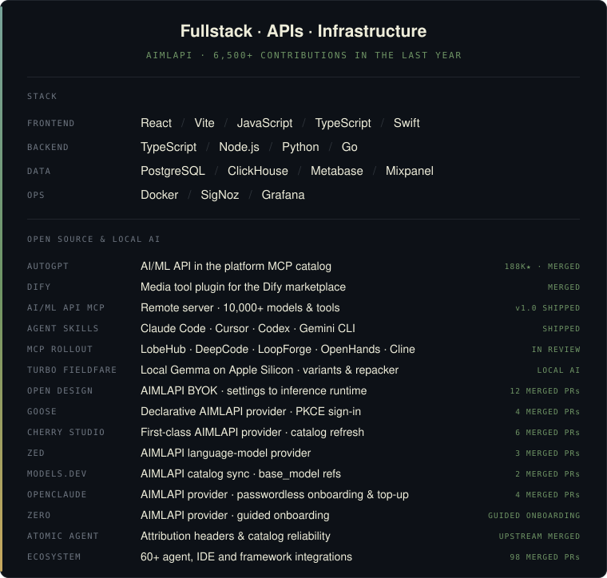

  

  

  <picture>
    <source media="(prefers-color-scheme: light)" srcset="https://raw.githubusercontent.com/Lookoff-AIMLAPI/Lookoff-AIMLAPI/main/assets/profile-light.svg?v=light-20261124">
    
  </picture> 
  <a href="https://aimlapi.com/gh"><picture>
    <source media="(prefers-color-scheme: light)" srcset="https://raw.githubusercontent.com/Lookoff-AIMLAPI/Lookoff-AIMLAPI/main/assets/footer-light.svg?v=light-20261029">
    
  </picture></a>

